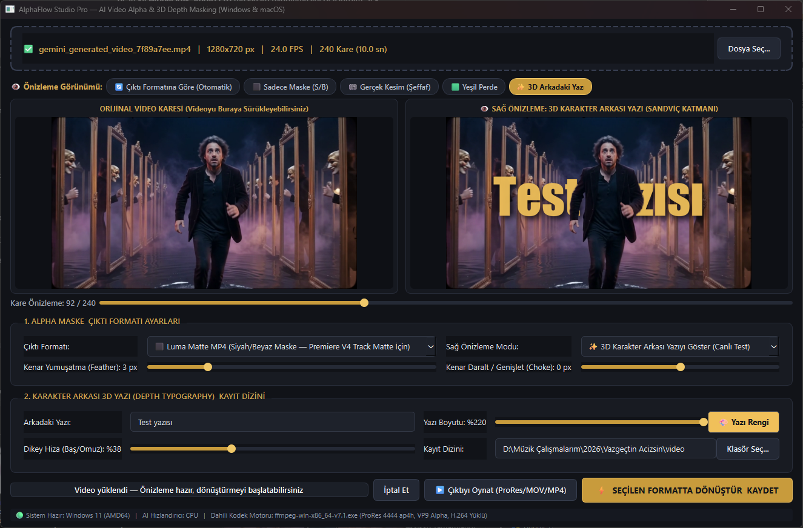
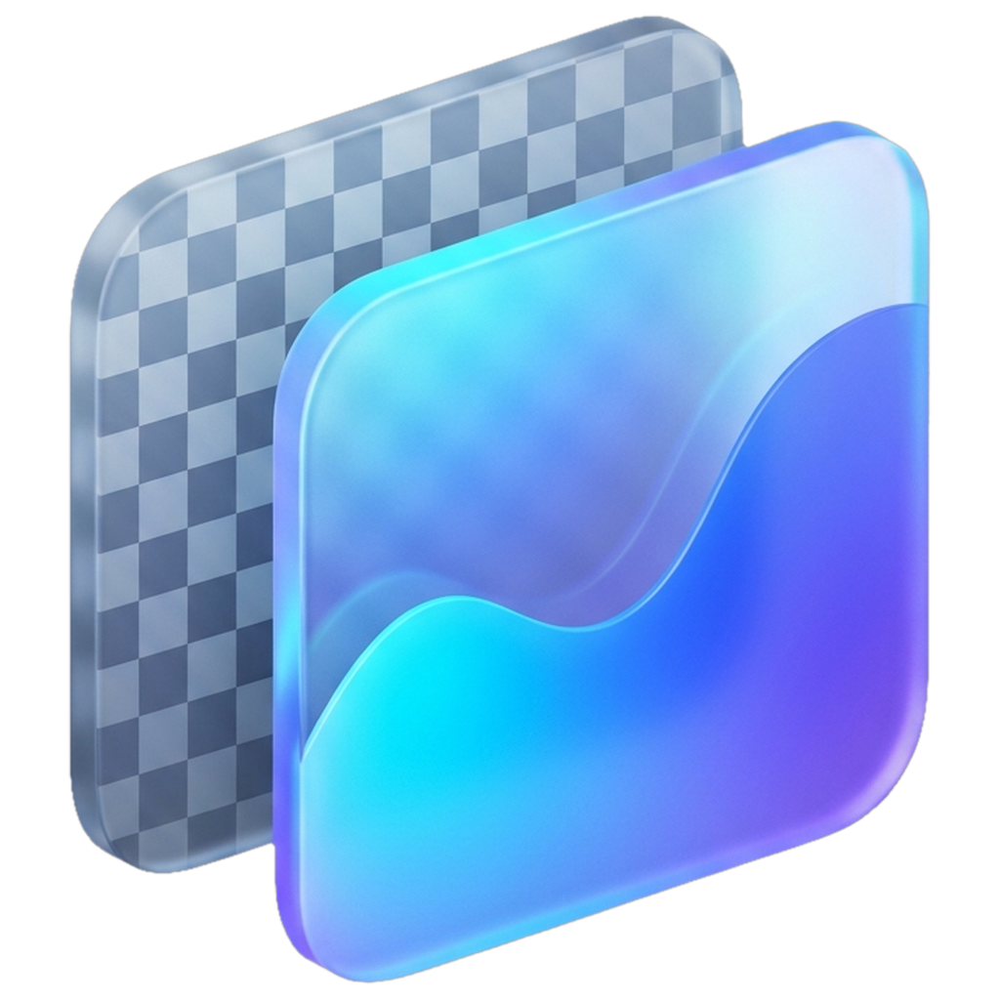
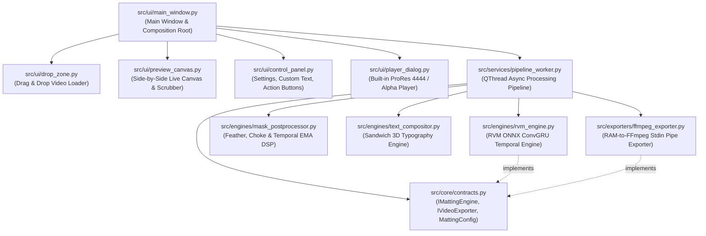

# AlphaFlow Studio Pro

<p align="center">
  
</p>

<p align="center">
  
</p>

<p align="center">
  <strong>Next-Generation Local AI Video Alpha Matting, Luma Matte & 3D Depth Typography Desktop Studio</strong><br />
  <em>Yeşil perdeye ihtiyaç duymadan her türlü videodaki insan ve nesneleri yapay zeka ile saniyeler içinde arka plandan ayırarak stüdyo kalitesinde şeffaf (ProRes 4444 / VP9 Alpha), Luma Matte ve karakter arkası 3D sinematik tipografi çıktıları üreten, tamamen cihaz içi (offline) ve çapraz platform bir video maskeleme stüdyosudur.</em>
</p>

<p align="center">
  
  
  
  
  
  
  
</p>

---

## 🌟 Overview

**AlphaFlow Studio Pro** is a frameless, Apple HIG glassmorphic cross-platform desktop application (**Flutter Desktop + Local Python AI Bridge**) engineered for video creators, VFX compositors, and motion designers. It extracts both **human portraits (`RVM`)** and **general objects, animals, origami, products, and VFX (`Multi-Scale U2NetP + CIE-LAB/Focus Saliency`)** from standard video footage and generates production-ready **Alpha Video (`ProRes 4444 .mov` / `VP9 .webm`)**, **Luma Track Matte (`H.264 .mp4`)**, and **In-Camera 3D Depth Typography (`SAMPLE TEXT` Behind Subject)** — all running 100% locally on your hardware with automatic **Turkish (`tr`) / English (`en`)** OS localization and **Dark / Light Mode**.

Say goodbye to expensive cloud clipping subscriptions, green screens, tedious manual rotoscoping, and temporal flickering.

---

## 🚀 Key Highlights

- **🔒 100% Offline & Privacy-First:** No frame ever leaves your computer. No cloud queues, upload limits, or data leaks.
- **⚡ Real-Time Zero-Flicker AI Engine:** Powered by ByteDance's **Robust Video Matting (RVM)** architecture featuring **ConvGRU temporal memory cells**. Unlike single-frame decouping models (Rembg / U2Net) that cause severe edge shimmering and boiling artifacts, AlphaFlow maintains smooth temporal coherence across frames at 40–90+ FPS.
- **🎬 5 Professional Production Output Modes:**
  1. **Luma Track Matte (`_luma_matte.mp4`):** Ultra-compact (5–15 MB) black-and-white mask video designed specifically for Adobe Premiere Pro and After Effects `Track Matte Key`.
  2. **True Transparent Apple ProRes 4444 (`_alpha_prores4444.mov`):** Industry-standard 10-bit lossless alpha channel video (`yuva444p10le`) ready for drag-and-drop into Premiere Pro, DaVinci Resolve, Final Cut Pro, and After Effects.
  3. **WebM VP9 Alpha (`_alpha_vp9.webm`):** Modern, lightweight transparent video (`yuva420p`) for web applications, game engines, and OBS Studio.
  4. **Green Screen Chroma Key (`_greenscreen.mp4`):** Background cleanly replaced with studio-standard chroma green (`#00D700`) for universal software compatibility.
  5. **Direct 3D Depth Typography (`_3d_text.mp4`):** Renders cinematic text directly behind the subject with drop shadows, customized fonts, sizing, positioning, and colors in one step.
- **🎛️ Real-Time DSP Mask Refinement:** Live edge feathering (Gaussian blur), choke/spread (morphological dilation/erosion), thresholding, and temporal EMA (Exponential Moving Average) smoothing.
- **📺 Interactive Dual-Canvas & Timeline Scrubber:** Side-by-side Before/After preview with instant frame scrubbing, mode switcher pills, and direct drag-and-drop support on both the header and preview canvas.
- **▶️ Built-in ProRes 4444 (`ap4h`) Studio Player:** Solves the common Windows limitation where default media players cannot play Apple ProRes 4444 or WebM alpha videos. Preview your exports inside the application with frame scrubbing and one-click file reveal.
- **🚀 RAM-to-FFmpeg Zero-Disk-Clutter Pipe:** Frames are streamed directly from RAM into the FFmpeg `stdin` pipe without generating thousands of temporary PNG files on your SSD, preserving full original audio fidelity.
- **🍏 Native Hardware Acceleration & Self-Bootstrapping:** Automatically detects **NVIDIA CUDA** or **DirectML** on Windows, and **Apple Silicon CoreML** on macOS. Missing dependencies and AI models are downloaded and verified automatically on launch.

---

## 📸 Interface & Workflow

```text
┌────────────────────────────────────────────────────────────────────────┐
│                        ALPHAFLOW STUDIO PRO                            │
├────────────────────────────────────────────────────────────────────────┤
│  [+] Drag & Drop Video File Here (.mp4, .mov, .avi, .mkv)              │
├──────────────────────────────────┬─────────────────────────────────────┤
│   ORIGINAL FRAME PREVIEW         │   PROCESSED / ALPHA / 3D TEXT       │
│                                  │                                     │
│     [ Subject in Scene ]         │     [ Text Behind Subject / Alpha ] │
│                                  │                                     │
├──────────────────────────────────┴─────────────────────────────────────┤
│  Timeline Scrubber:  [====●=============================] Frame 48/320 │
├────────────────────────────────────────────────────────────────────────┤
│  1. ALPHA MASK & EXPORT FORMAT SETTINGS                                │
│     Export Format: [ Luma Matte MP4 (B&W Track Matte) ▼ ]              │
│     Preview Mode:  [ Auto (Follow Export Format)      ▼ ]              │
│     Feather: [ 3 px ]    Choke: [ 0 px ]                               │
│                                                                        │
│  2. 3D DEPTH TYPOGRAPHY & OUTPUT DIRECTORY                             │
│     Text Behind Subject: [ NEVER GIVE UP             ]                 │
│     Font Size: [ 100% ]  Vertical Position: [ 40% ]  Color: [ 🎨 Gold ]│
│     Output Folder: [ Source video directory          ] [ Browse... ]   │
├────────────────────────────────────────────────────────────────────────┤
│  Progress: [====================================] 100%                 │
│  [ Cancel ]   [ ▶️ Play Output (ProRes/MP4) ]   [ ⚡ CONVERT & SAVE ]   │
│                                                                        │
│  🟢 System Ready: Windows 11 | AI: CUDA / CoreML | Codec: FFmpeg ap4h  │
└────────────────────────────────────────────────────────────────────────┘
```

---

## 🛠️ Supported Formats & Codecs

| Export Mode | File Suffix | Codec & Pixel Format | Typical File Size | Primary Use Case |
| :--- | :--- | :--- | :--- | :--- |
| **Luma Track Matte** | `*_luma_matte.mp4` | H.264 `yuv420p` | ~5 – 15 MB | Premiere Pro V4 Track Matte Key (Fastest & Smallest) |
| **Apple ProRes 4444** | `*_alpha_prores4444.mov` | ProRes 4444 (`ap4h`) `yuva444p10le` | ~150 – 500 MB | Premiere Pro, DaVinci Resolve, After Effects RGBA layer |
| **WebM VP9 Alpha** | `*_alpha_vp9.webm` | VP9 `yuva420p` | ~15 – 45 MB | OBS Studio overlays, Web animations, Game engines |
| **Green Screen** | `*_greenscreen.mp4` | H.264 `yuv420p` (`#00D700`) | ~10 – 30 MB | Ultra Key / Chroma Key in any editing software |
| **3D Depth Text** | `*_3d_text.mp4` | H.264 `yuv420p` + Text layer | ~10 – 30 MB | Standalone ready-to-publish reels, shorts, TikToks |

---

## 📥 Installation & Quick Start

### Prerequisites
- **Python:** 3.10, 3.11, or 3.12 installed ([python.org](https://www.python.org/downloads/))
- **Operating System:** Windows 10/11 (64-bit) or macOS 12+ (Intel & Apple Silicon M1/M2/M3/M4)
- **Git** (optional, to clone repository)

### 1. Clone or Download Repository
```bash
git clone https://github.com/umitunc/AlphaFlow.git
cd AlphaFlow
```

### 2. Launch the Application

#### On Windows:
Double-click `start_alphaflow.bat` or run:
```powershell
python main.py
```

#### On macOS:
Double-click `start_alphaflow.command` or run:
```bash
python3 main.py
```

> [!NOTE]
> **Self-Bootstrapping:** On the very first run, AlphaFlow's built-in bootstrap manager will automatically check your Python environment, install any missing dependencies (`PySide6`, `onnxruntime`, `opencv-python`, `numpy`, `Pillow`, `imageio-ffmpeg`), and download the verified RVM ONNX model weights (`models/rvm_mobilenetv3_fp32.onnx`).

### Manual Dependency Installation (Optional)
If you prefer managing your virtual environment manually:
```bash
python -m venv .venv
# Windows:
.venv\Scripts\activate
# macOS/Linux:
source .venv/bin/activate

pip install -r requirements.txt
python main.py
```

---

## 🎨 Creative Editing Workflows

### 1. 3D Depth Typography in Adobe Premiere Pro (Recommended)
Creating the popular **"Text Behind Person"** effect takes under 30 seconds using the **Luma Matte MP4**:

1. In AlphaFlow, select **Luma Matte MP4** and click **Convert & Save**.
2. Open Adobe Premiere Pro and place your media onto the timeline:
   - **Track V1:** Original background video clip.
   - **Track V2:** Your Title / Text layer (any font, color, animation).
   - **Track V3:** Duplicate of the original video clip.
   - **Track V4:** The generated `*_luma_matte.mp4` file.
3. Select the clip on **Track V3**, open **Effects**, and add **Track Matte Key**.
4. In **Effect Controls**:
   - **Matte:** Set to `Video 4`.
   - **Composite Using:** Set to `Matte Luma`.
5. *Result:* Your text layer now appears perfectly sandwiched behind the character with zero edge artifacts!

---

### 2. Direct Transparent Layer in DaVinci Resolve & After Effects
1. In AlphaFlow, select **Apple ProRes 4444 MOV** or **WebM VP9 Alpha**.
2. Click **Convert & Save**.
3. Drag the resulting file into DaVinci Resolve or Adobe After Effects.
4. The video opens natively with an active 10-bit transparent alpha channel — place text, 3D graphics, particles, or new background environments underneath it on the timeline.

---

### 3. All-in-One Instant 3D Text (No Video Editor Required)
1. Drag your video into AlphaFlow.
2. Under **2. 3D Depth Typography**, enter your text (e.g. `NEVER GIVE UP`, UTF-8 Turkish characters fully supported).
3. Adjust the **Font Size**, **Vertical Position**, and pick a custom **Color**.
4. Select **3D Character Behind Text MP4** as the export format.
5. Click **Convert & Save** — the app outputs a finalized, compressed `.mp4` ready for Instagram Reels, YouTube Shorts, or TikTok.

---

## 🏗️ Architecture & SOLID Design

AlphaFlow Studio Pro is strictly built following **SOLID** design principles. Every module has a single responsibility and is decoupled through abstract interfaces:



### Directory Structure

```text
AlphaFlow/
├── docs/
│   ├── implementation-plan.md     # Detailed architecture and planning documentation
│   └── ss/image.png               # Application screenshot
├── models/                        # Auto-downloaded RVM ONNX model weights
├── src/
│   ├── core/
│   │   ├── bootstrap.py           # Self-healing dependency checker & installer
│   │   ├── contracts.py           # Abstract interfaces (IMattingEngine, IVideoExporter) & Configs
│   │   └── platform_utils.py      # Cross-platform utilities (Explorer/Finder, Fonts, GPU detection)
│   ├── engines/
│   │   ├── model_downloader.py    # Automatic RVM weight downloader
│   │   ├── rvm_engine.py          # Robust Video Matting (ConvGRU) ONNX inference
│   │   ├── mask_postprocessor.py  # DSP edge feathering, choke/spread & temporal EMA smoothing
│   │   └── text_compositor.py     # 3D Depth Typography (Sandwich layer compositing)
│   ├── exporters/
│   │   └── ffmpeg_exporter.py     # Zero-disk-clutter FFmpeg stdin pipe (ProRes, VP9, MP4)
│   ├── services/
│   │   └── pipeline_worker.py     # Asynchronous QThread orchestration & live telemetry
│   └── ui/
│       ├── control_panel.py       # Sliders, color picker, export picker, progress bar
│       ├── drop_zone.py           # Drag & Drop landing zone
│       ├── main_window.py         # Main application window & event wiring
│       ├── player_dialog.py       # Custom ProRes 4444 (ap4h) & Alpha video player
│       ├── preview_canvas.py      # Dual preview panels & interactive timeline scrubber
│       └── theme.py               # Modern Studio Dark stylesheet (QSS)
├── build_standalone.py            # PyInstaller packaging script (.exe / .app)
├── main.py                        # Application entry point
├── requirements.txt               # Dependency specifications
├── start_alphaflow.bat            # Windows 1-click launcher
└── start_alphaflow.command        # macOS 1-click launcher
```

---

## 📦 Building a Standalone Executable

You can compile AlphaFlow into a completely standalone binary containing all Python runtimes, FFmpeg binaries, and the AI model:

```bash
python build_standalone.py
```

- **Windows:** Generates `dist/AlphaFlowStudio/AlphaFlowStudio.exe` (no Python or FFmpeg installation required on target PCs).
- **macOS:** Generates `dist/AlphaFlowStudio.app` (notarizable application bundle).

---

## ⚙️ Configuration & Fine-Tuning Guide

| Parameter | Default | Range | Description |
| :--- | :--- | :--- | :--- |
| **Tolerance (Sensitivity)** | `50%` | `5% – 95%` | Controls foreground extraction sensitivity, multi-scale logit gamma, and connected-component filtering. |
| **Downsample Ratio** | `0.35` | `0.20 – 0.50` | Internal model resolution. Lower values increase FPS; higher values capture fine hair details. |
| **Feather** | `3 px` | `0 – 15 px` | Softens mask edges using Gaussian blur to eliminate harsh silhouettes. |
| **Choke / Spread** | `0 px` | `-8 to +8 px` | Negative values shrink the mask to remove green/background fringe; positive values expand it. |
| **Temporal EMA** | `0.20` | `0.0 – 0.70` | Exponential Moving Average weighting across consecutive frames to suppress micro-jitter. |
| **Text Scale** | `100%` | `40% – 220%` | Dynamic typography scaling relative to video resolution. |
| **Vertical Position** | `40%` | `10% – 90%` | Vertical placement behind head, chest, or torso. |

---

## 🤝 Contributing

Contributions, bug reports, and feature suggestions are welcome!
1. Fork the Project
2. Create your Feature Branch (`git checkout -b feature/AmazingFeature`)
3. Commit your Changes (`git commit -m 'Add some AmazingFeature'`)
4. Push to the Branch (`git push origin feature/AmazingFeature`)
5. Open a Pull Request

---

## 📜 License & Acknowledgments

- **License:** Distributed under the MIT License.
- **AI Core:** Built upon [RobustVideoMatting](https://github.com/PeterL1n/RobustVideoMatting) by ByteDance.
- **GUI Engine:** Powered by [Qt for Python (PySide6)](https://wiki.qt.io/Qt_for_Python).
- **Media Engine:** Powered by [FFmpeg](https://ffmpeg.org/) via [imageio-ffmpeg](https://github.com/imageio/imageio-ffmpeg).
