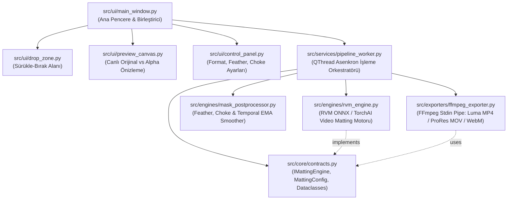

# AlphaFlow Studio — Yerel AI Video Alpha & Luma Matte Masaüstü Uygulaması
## Mimari Tasarım ve Uygulama Planı (Implementation Plan)

**AlphaFlow Studio**, video kliplerde (ör. *3D Depth Typography / Karakter Arkası Yazı*, görsel efekt kompozisyonu, arka plan değiştirme) kullanılmak üzere video dosyalarını bulut servislerine (Canva vb.) yüklemeye gerek kalmadan, yerel bilgisayarda **Sürükle-Bırak (Drag & Drop)** kolaylığıyla **Alpha Kanalına (`ProRes 4444 .mov` / `VP9 .webm`)** ve **Luma Track Matte (`Siyah-Beyaz Maske .mp4`)** formatına dönüştüren, **SOLID** prensiplerine uygun modüler bir Python masaüstü uygulamasıdır.

---

## 1. Hangi Kütüphaneleri ve Teknolojileri Kullanacağız? (Nedenleriyle)

Video maskeleme (Video Matting), tekil fotoğraf dekupajından çok farklıdır. Fotoğraf modellerini (`Rembg` / `U2Net`) videonun her karesine tek tek uygularsanız, saç ve omuz kenarlarında her karede değişen **titreme (flickering/boiling)** oluşur. Bu sorunu çözmek için endüstri standardı şu teknoloji yığını seçilmiştir:

| Katman | Kütüphane / Teknoloji | Seçilme Nedeni (Best Practice) |
| :--- | :--- | :--- |
| **Masaüstü UI & Drag-Drop** | **`PySide6` (Qt6 for Python)** | İşletim sistemi düzeyinde doğal Sürükle-Bırak (`QDragEnterEvent` / `QDropEvent`), donmayan arayüz için `QThread` + `Signal/Slot` mimarisi ve yüksek FPS'li canlı kare önizleme (`QImage` / `QPixmap`) sunar. |
| **Birincil AI Video Motoru** | **`RobustVideoMatting (RVM)` (`ONNX Runtime` / `TorchScript`)** | ByteDance tarafından geliştirilen RVM modeli, içinde **ConvGRU (Zamansal Hafıza Hücresi)** barındırır. Önceki karelerin maskesini hafızada tuttuğu için saç ve omuz kenarlarında **sıfır titreme (zero-flicker)** ile gerçek zamanlı (`40–90 FPS`) alpha maskesi üretir. |
| **Maske Son-İşleme (DSP)** | **`OpenCV (cv2)` + `NumPy`** | Üretilen Alpha maskesi üzerinde gerçek zamanlı **Kenar Yumuşatma (`Feather / Gaussian Blur`)**, **Kenar Daraltma/Genişletme (`Morphological Choke/Spread`)**, **Kontrast/Threshold** ve **Zamansal EMA (Exponential Moving Average)** yumuşatması yapar. |
| **Video Kodlama & Alpha Pipe** | **`imageio-ffmpeg` (FFmpeg Subprocess Pipe)** | Diskte binlerce geçici `.png` oluşturmadan (sıfır disk şişmesi), kareleri RAM üzerinden doğrudan FFmpeg `stdin` borusuna (pipe) aktarır. Orijinal ses kanalını koruyarak 4 farklı profesyonel formatta çıktı üretir. |

---

## 2. Desteklenen Çıktı Formatları (Premiere Pro & After Effects Uyumlu)

Uygulama, kurgu programındaki kullanım amacınıza göre **4 çıktı modunu** destekler:

1. **Luma Track Matte (`_matte.mp4` — H.264 Siyah-Beyaz Maske) *(Varsayılan & En Pratik)*:**
   - Karakteri **Bembeyaz (`255`)**, arka planı **Simsiyah (`0`)** olarak kodlar.
   - Dosya boyutu çok küçüktür (`5–15 MB`). Adobe Premiere Pro'da `V3` katmanına koyup `Track Matte Key` seçildiğinde yazıyı karakterin arkasına (**3D Depth Typography**) saniyeler içinde geçirir.
2. **Gerçek Şeffaf Video — Apple ProRes 4444 (`_alpha.mov` — `yuva444p10le`):**
   - Profesyonel kurgu programlarına (Premiere Pro, DaVinci Resolve, After Effects) doğrudan şeffaf katman olarak sürüklenip bırakılabilen kayıpsız 10-bit Alpha kanallı video.
3. **Web/Hafif Şeffaf Video — WebM VP9 Alpha (`_alpha.webm` — `yuva420p`):**
   - Düşük dosya boyutlu, gömülü Alpha kanallı modern şeffaf video formatı.
4. **Yeşil Perde / Chroma (`_greenscreen.mp4` — H.264):**
   - Arka planı stüdyo yeşiline (`#00FF00`) dönüştürülmüş, her programda `Ultra Key / Chroma Key` ile açılabilen video.

---

## 3. SOLID Prensiplerine Göre Modüler Mimari

Dosyaların şişmesini (God Object / spagetti kod) önlemek için her dosyanın **maksimum 80–140 satır** olduğu, tek sorumluluklu katmanlı mimari uygulanmıştır:



### SOLID Prensiplerinin Kodda Uygulanışı

1. **S — Single Responsibility (Tek Sorumluluk Prensibi):**
   - `rvm_engine.py` yalnızca yapay zeka ile ham Alpha matrisi üretir; dosya kaydetmez veya arayüz güncellemez.
   - `mask_postprocessor.py` yalnızca maskenin kenar yumuşatma (`feather`), daraltma (`choke`) ve zamansal titreme engelleme (`temporal smoothing`) matematiğini yapar.
   - `ffmpeg_exporter.py` yalnızca ham kareleri FFmpeg borusuna (pipe) gönderip video konteynerine yazar.
   - `preview_canvas.py` yalnızca ekranda Orijinal Kare ile Damalı (Checkerboard) Alpha önizlemesini çizer.
2. **O — Open/Closed (Açık/Kapalı Prensibi):**
   - İleride `SAM-2` veya `BiRefNet` gibi yeni bir segmentasyon modeli eklemek istediğinizde `pipeline_worker.py` veya UI kodlarına hiç dokunulmaz; yalnızca `IMattingEngine` soyut sınıfından türeyen yeni bir motor sınıfı yazılır.
3. **L — Liskov Substitution (Liskov Yerine Geçme Prensibi):**
   - Tüm motor sınıfları (`RVMVideoEngine`, `HybridSilhouetteEngine`) aynı `extract_alpha(frame_bgr) -> np.ndarray` kontratını sağlar ve çalışma anında birbirinin yerine takılabilir.
4. **I — Interface Segregation (Arayüz Ayrımı Prensibi):**
   - Arayüz bileşenleri arka plan motorunun PyTorch/ONNX detaylarını bilmez; yalnızca `WorkerSignals` (`progress_updated`, `frame_preview_ready`, `finished_ok`, `error_occurred`) sinyallerini dinler.
5. **D — Dependency Inversion (Bağımlılıkların Tersine Çevrilmesi):**
   - İş akışı yöneticisi (`VideoMattingWorker`), somut sınıflara değil `src/core/contracts.py` içindeki soyut arayüzlere (`IMattingEngine`) bağımlıdır.

---

## 4. Klasör ve Dosya Ağacı (`D:\Works\2026\AlphaFlow`)

```text
D:\Works\2026\AlphaFlow\
├── docs/
│   └── implementation-plan.md       # Mimari ve uygulama planı
├── models/                          # Otomatik indirilen/önbelleklenen hafif RVM modeli (.onnx / .pt)
├── src/
│   ├── __init__.py
│   ├── core/
│   │   ├── __init__.py
│   │   └── contracts.py             # Veri modelleri (MattingConfig, ExportMode) ve IMattingEngine arayüzü
│   ├── engines/
│   │   ├── __init__.py
│   │   ├── model_downloader.py      # RVM model ağırlıklarını ilk çalışmada otomatik indiren yardımcı
│   │   ├── rvm_engine.py            # Robust Video Matting (zamansal hafızalı) çıkarım motoru
│   │   └── mask_postprocessor.py    # Feather, Choke/Spread, Threshold ve Temporal EMA filtreleri
│   ├── exporters/
│   │   ├── __init__.py
│   │   └── ffmpeg_exporter.py       # Luma MP4, ProRes 4444 MOV, VP9 WebM ve GreenScreen kodlayıcı
│   ├── services/
│   │   ├── __init__.py
│   │   └── pipeline_worker.py       # QThread tabanlı asenkron video işleme ve canlı önizleme servisi
│   └── ui/
│       ├── __init__.py
│       ├── theme.py                 # Modern koyu (Dark Glass) QSS stil tanımları
│       ├── drop_zone.py             # Sürükle-Bırak (Drag & Drop) video seçim bileşeni
│       ├── preview_canvas.py        # Yan yana (Orijinal + Damalı Alpha / Matte) canlı önizleme ekranı
│       ├── control_panel.py         # Çıktı formatı, Feather, Choke ve hedef klasör ayar paneli
│       └── main_window.py           # Ana pencere ve bileşen orkestrasyonu
├── main.py                          # Uygulama başlatıcı (Entry Point)
├── requirements.txt                 # Bağımlılık listesi
└── start_alphaflow.bat              # Tek tıkla çalıştırma betiği
```

---

## 5. Adım Adım Çalışma Akışı (Kullanıcı Deneyimi)

1. **Sürükle ve Bırak (Drag & Drop):**
   - Kullanıcı `.mp4`, `.mov`, `.avi` veya `.mkv` uzantılı video klibini doğrudan uygulama penceresine sürükleyip bırakır.
2. **Anında İlk Kare Analizi ve Canlı Önizleme:**
   - Video bırakıldığı anda uygulama videonun ortasından örnek bir kare alır, AI motorundan geçirir ve **Sol tarafta Orijinal Kareyi**, **Sağ tarafta ise Damalı (Checkerboard) Şeffaf Kesimi / Alpha Maskesini** anında gösterir.
   - Kullanıcı **Kenar Yumuşatma (`Feather`)**, **Kenar Daraltma (`Choke`)** veya **Önizleme Modu (`Şeffaf Damalı` / `Siyah-Beyaz Luma Matte` / `Yeşil Perde`)** kaydırıcılarını oynattıkça sağdaki önizleme anında güncellenir!
3. **Dönüştür ve Kaydet (`Dönüştür` Butonu):**
   - Kullanıcı **"Maskelenmiş Videoyu Kaydet"** butonuna bastığında `PipelineWorker` arka planda (`QThread`) çalışmaya başlar.
   - Her işlenen kare hem canlı olarak önizleme ekranında akar hem de ilerleme çubuğunda (`%` ve `FPS`) gösterilir.
   - İşlem bittiğinde videonun bulunduğu klasöre (veya seçilen hedef dizine) `_matte.mp4` veya `_alpha.mov` / `_alpha.webm` olarak kaydedilir ve klasör otomatik gösterilir.


---

## 9. Çapraz Platform (Windows & macOS), Otomatik Kurulum ve Dahili ProRes Oynatıcı

Uygulamanın herhangi bir Windows veya macOS bilgisayarda sıfır kurulum hatasıyla çalışması ve profesyonel kodekleri (`ap4h` / Apple ProRes 4444) harici oynatıcıya ihtiyaç duymadan açabilmesi için aşağıdaki modüller eklenmiştir:

1. **Otomatik Kütüphane ve Model Kurucu (`src/core/bootstrap.py`):**
   - Sadece standart Python kütüphanesini (`importlib.util`, `subprocess`) kullanarak uygulama açılışında `PySide6`, `onnxruntime`, `opencv-python`, `numpy`, `Pillow` ve `imageio-ffmpeg` paketlerini denetler; eksik olanları otomatik olarak `pip` üzerinden kurar.
2. **Windows & macOS İşletim Sistemi Soyutlama Katmanı (`src/core/platform_utils.py`):**
   - **Donanım Hızlandırma:** Windows'ta `CUDAExecutionProvider` / `DmlExecutionProvider`, macOS Apple Silicon (M1/M2/M3/M4) cihazlarda `CoreMLExecutionProvider` ve yedek olarak `CPUExecutionProvider` seçer.
   - **Dosya Yöneticisi Entegrasyonu:** Windows'ta `explorer /select,`, macOS'ta `open -R` ile çıktı dosyasını doğrudan klasörde seçili gösterir.
   - **Sistem Fontları:** Windows (`C:\Windows\Fonts`) ve macOS (`/System/Library/Fonts`) için Türkçe UTF-8 destekli kalın tipografi fontlarını otomatik bulur.
3. **Dahili ProRes 4444 (`ap4h`) & Alpha Video Oynatıcı (`src/ui/player_dialog.py`):**
   - Windows Media Player'ın açamadığı `Apple ProRes 4444 (.mov / ap4h)` ve `WebM VP9 Alpha (.webm)` dosyalarını uygulama içindeki FFmpeg/OpenCV motoruyla doğrudan oynatır (`StudioVideoPlayerDialog`).
4. **Tek Tıkla Bağımsız Paketleme (`build_standalone.py`):**
   - PyInstaller ile hem Windows (`dist/AlphaFlowStudio.exe`) hem de macOS (`dist/AlphaFlowStudio.app`) için tüm FFmpeg ikililerini ve AI modelini içeren taşınabilir uygulama paketi üretir.
